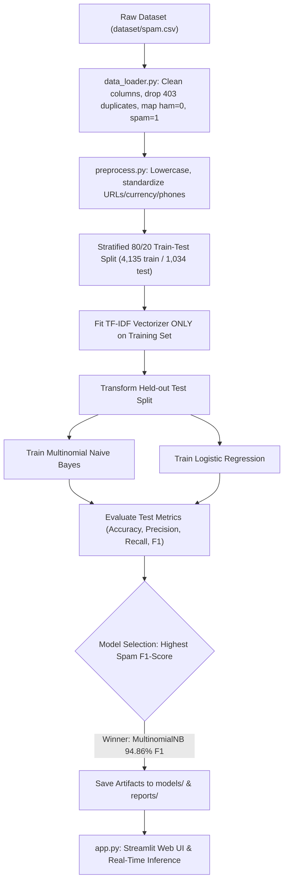

# 🛡️ Spam Message Classification System

[](https://share.streamlit.app/new?repository=meet2shrishtichaudhary-svg/Spam-Message-Classification&branch=main&mainModule=app.py)

An educational end-to-end Machine Learning minor project built with Python and Streamlit to classify SMS text messages into **Spam** (unwanted, promotional, suspicious) and **Ham** (legitimate, personal, normal messages).

---

## 1. Project Overview & Problem Statement

Short Message Service (SMS) remains a critical communication channel for personal messaging, two-factor authentication (2FA), banking, and logistics. However, users are increasingly bombarded with deceptive promotional broadcasts, lottery scams, phishing attacks, and malicious links.

Manually filtering these messages is tedious and error-prone. This project builds a lightweight, transparent, and interpretable text classification system using Natural Language Processing (NLP) and supervised Machine Learning algorithms to automatically flag spam messages while safeguarding legitimate communications.

> **Academic Notice:** This is an educational minor project developed for B.Tech AI & ML academic demonstrations and viva presentation. It is not intended as a replacement for carrier-grade production cybersecurity or fraud-detection firewalls.

---

## 2. Main Objectives

1. **Dataset Loading & Hygiene:** Ingest the Kaggle SMS Spam Collection, normalize legacy column schemas (`v1`, `v2`), eliminate duplicate messages, and handle non-standard encodings (`latin-1`).
2. **Deterministic Preprocessing:** Standardize raw text by normalizing case, standardizing spam-specific patterns (URLs, currency symbols, and phone numbers), and preserving critical negation words (`not`, `no`, `never`).
3. **Leakage-Safe Feature Extraction:** Transform text into numerical feature vectors using **TF-IDF (Term Frequency-Inverse Document Frequency)**, strictly fitting the vocabulary on training data only.
4. **Model Comparison & Metric-Driven Selection:** Train and benchmark **Multinomial Naive Bayes** against **Logistic Regression** on an identical held-out test set, selecting the champion based on **Spam-class F1-Score**.
5. **Interactive Streamlit Web Interface:** Deliver a responsive, modern web UI for real-time inference with probability estimation, sample presets, and confusion matrix visualization.
6. **Robustness & Automated Testing:** Provide automated Pytest unit and integration tests covering synthetic fixtures, input validation, and edge cases.

---

## 3. Key Features

- **No Data Leakage:** Stratified 80/20 train/test split performed before fitting the TF-IDF vectorizer.
- **Spam Signal Preservation:** Retains vital spam markers like `httpaddr`, `currencysymb` (£, $, €), and `phonenbr` rather than naively stripping them away.
- **F1-Score Driven Model Selection:** Avoids the "accuracy paradox" of imbalanced datasets (87% Ham vs 13% Spam) by prioritizing harmonic F1-score on the minority Spam class.
- **Persistent Model Artifacts:** Saves trained models and vectorizers using Joblib for sub-millisecond inference without retraining.
- **Modern Streamlit Dashboard:** Features real-time probability estimates, preprocessing inspectors, confusion matrix plots, and viva study notes.
- **Zero Heavy Infrastructure:** Runs 100% locally with no databases, external cloud APIs, or container overhead.

---

## 4. MVP Scope

| MVP Phase | Component | Key Deliverable | Status |
| :--- | :--- | :--- | :---: |
| **MVP 1** | Dataset Loading | `src/data_loader.py` with column mapping, deduplication & encoding handling | ✅ Completed |
| **MVP 2** | Text Preprocessing | `src/preprocess.py` with regex tokenization & negation preservation | ✅ Completed |
| **MVP 3** | Feature Extraction | Leakage-free `TfidfVectorizer` (unigrams + bigrams) | ✅ Completed |
| **MVP 4** | Model Training | `src/train.py` training Naive Bayes vs Logistic Regression | ✅ Completed |
| **MVP 5** | Evaluation & Reports | `src/evaluate.py` exporting metrics JSON & confusion matrix PNG | ✅ Completed |
| **MVP 6** | Streamlit Web App | `app.py` with interactive GUI, sample presets & confidence scores | ✅ Completed |
| **MVP 7** | Model Persistence | `src/predict.py` with Joblib loading & fast single-message inference | ✅ Completed |
| **MVP 8** | Automated Testing | 19 Pytest tests across `tests/` covering fixtures & edge cases | ✅ Completed (19/19) |

---

## 5. Technologies & Libraries

- **Programming Language:** Python 3.11 / 3.13
- **Data Manipulation:** `pandas`, `numpy`
- **Text Preprocessing:** Regular Expressions (`re`), standard string utilities, `nltk`
- **Feature Extraction:** `scikit-learn` (`TfidfVectorizer`)
- **Machine Learning Models:** `scikit-learn` (`MultinomialNB`, `LogisticRegression`)
- **Model Evaluation:** `scikit-learn.metrics` (`accuracy_score`, `precision_score`, `recall_score`, `f1_score`, `confusion_matrix`)
- **Visualization:** `matplotlib`, `seaborn`
- **Model Persistence:** `joblib`
- **Web Interface:** `streamlit`
- **Automated Testing:** `pytest`

---

## 6. Dataset Source & Local Placement

- **Dataset:** [SMS Spam Collection Dataset (Kaggle / UCI Machine Learning Repository)](https://www.kaggle.com/datasets/uciml/sms-spam-collection-dataset)
- **Local Path:** `dataset/spam.csv`
- **Expected Format:** CSV file containing columns `v1` (label: `ham` or `spam`) and `v2` (text message).

### Dataset Summary (After Cleaning):
- **Raw Records:** 5,572 rows
- **Duplicates Dropped:** 403 rows
- **Cleaned Dataset:** 5,169 unique messages
- **Class Distribution:**
  - **Ham (Legitimate):** 4,516 messages (87.37%) [Label: `0`]
  - **Spam (Unwanted):** 653 messages (12.63%) [Label: `1`]

---

## 7. Folder Structure

```
Spam-Message-Classification/
├── dataset/
│   ├── .gitkeep
│   └── spam.csv                     # Raw SMS Spam Collection dataset
├── models/
│   ├── .gitkeep
│   ├── best_model.joblib            # Champion trained model (MultinomialNB)
│   ├── tfidf_vectorizer.joblib      # Fitted TF-IDF vectorizer
│   └── model_metadata.json          # Hyperparameters and training metadata
├── reports/
│   ├── .gitkeep
│   ├── confusion_matrix.png         # Heatmap plot of test confusion matrix
│   ├── metrics.json                 # Evaluation metrics of best model
│   └── model_comparison.json        # Comparative benchmark of candidate models
├── src/
│   ├── __init__.py
│   ├── data_loader.py               # Dataset loading, cleaning, and normalization
│   ├── preprocess.py                # Reusable regex and negation-safe text cleaner
│   ├── train.py                     # Split, vectorize, train, compare, and save
│   ├── evaluate.py                  # Metrics calculation and confusion matrix plotting
│   └── predict.py                   # Artifact loading and single-message prediction
├── tests/
│   ├── __init__.py
│   ├── test_data_loader.py          # Unit tests for loading and schema normalization
│   ├── test_preprocess.py           # Unit tests for text cleaning and tokenization
│   └── test_predict.py              # Unit tests for prediction and synthetic training
├── app.py                           # Modern Streamlit web interface
├── requirements.txt                 # Project dependencies
├── .gitignore                       # Git exclusion rules
└── README.md                        # Documentation and viva study guide
```

---

## 8. System Architecture & Workflow



---

## 9. Installation & Setup Guide (Windows & VS Code)

### Prerequisites
- Python 3.10, 3.11, 3.12, or 3.13 installed.
- VS Code (or your preferred editor) installed.

### Step 1: Open the Project in VS Code
Open VS Code, press `Ctrl + O` (or `File -> Open Folder...`), and select the `Spam-Message-Classification` folder.

### Step 2: Open a PowerShell Terminal
In VS Code, press `` Ctrl + ` `` to open the integrated terminal.

### Step 3: Create and Activate a Virtual Environment
```powershell
# Create a local virtual environment named .venv
python -m venv .venv

# Activate the virtual environment
.\.venv\Scripts\Activate.ps1
```
*(If PowerShell displays an execution policy error, run `Set-ExecutionPolicy -Scope Process -ExecutionPolicy Bypass` and re-run the activate command).*

### Step 4: Install Dependencies
```powershell
pip install -r requirements.txt
```

---

## 10. How to Run the Project

### A. Train and Evaluate Models
To train both models, run the comparison pipeline, and export artifacts:
```powershell
python src/train.py
```

### B. Launch the Streamlit Web Application
To start the interactive web application:
```powershell
streamlit run app.py
```
Open your browser and navigate to: `http://localhost:8501`.

### C. Run Automated Tests
To execute all 19 unit and integration tests:
```powershell
pytest -v
```

---

## 11. Model Evaluation Results (Verified Benchmarks)

Both models were trained on 4,135 messages and evaluated on the exact same held-out test split of **1,034 messages** (903 Ham, 131 Spam):

| Metric | Multinomial Naive Bayes (Champion) | Logistic Regression |
| :--- | :---: | :---: |
| **Overall Accuracy** | **98.74%** | 97.49% |
| **Spam Precision (PPV)** | 98.36% | **99.07%** |
| **Spam Recall (Sensitivity)** | **91.60%** (120/131 caught) | 80.92% (106/131 caught) |
| **Spam F1-Score (Primary Metric)** | **94.86%** | 89.08% |
| **False Positives (FP)** | 2 | 1 |
| **False Negatives (FN)** | **11** | 25 |

### Confusion Matrix Breakdown (Naive Bayes on Test Set):
- **True Negatives (TN) = 901**: Legitimate messages correctly classified as Ham.
- **False Positives (FP) = 2**: Legitimate messages mistakenly flagged as Spam.
- **False Negatives (FN) = 11**: Spam messages that escaped detection and entered the inbox.
- **True Positives (TP) = 120**: Spam messages correctly flagged and blocked.

### Why Multinomial Naive Bayes was Selected:
While Logistic Regression achieved a slightly higher precision (99.07% vs 98.36%), it suffered from a significantly lower recall (80.92% vs 91.60%), missing 25 spam messages compared to only 11 missed by Naive Bayes. Multinomial Naive Bayes strikes an optimal balance with an outstanding **94.86% F1-Score**.

---

## 12. Illustrative Example Predictions

The table below shows example messages tested on the trained model:

| Example Message (Illustrative Input) | Model Category | Spam Probability | Explanation |
| :--- | :---: | :---: | :--- |
| `"Hey Mom, I'm heading home now. See you soon!"` | **Ham (Not Spam)** | **0.2%** | Standard conversational tokens, informal tone. |
| `"WINNER!! You have won a guaranteed £1000 prize or cash reward. Call 08452810075 now!"` | **Spam** | **100.0%** | Contains strong spam signals: `currencysymb`, `phonenbr`, urgent keywords (`winner`, `guaranteed`). |
| `"Can you send me the lecture notes when you get time?"` | **Ham (Not Spam)** | **0.2%** | Educational/conversational phrasing, no urgency or marketing tokens. |
| `"URGENT: Your bank account has been flagged. Verify details at http://security-update-fake.com"` | **Spam** | **96.9%** | Phishing pattern with `httpaddr`, panic-inducing language (`urgent`, `verify`). |

*(Note: Probabilities are estimated outputs from the fitted model, not absolute guarantees).*

---

## 13. Machine Learning Concepts (Viva Guide)

### What is TF-IDF?
**TF-IDF** stands for *Term Frequency-Inverse Document Frequency*.
- **Term Frequency (TF):** Measures how frequently a word appears in a specific message.
- **Inverse Document Frequency (IDF):** Penalizes ubiquitous words (like *"the"*, *"is"*, *"at"*) that appear across nearly all messages, giving higher mathematical weight to rare, discriminative words (like *"claim"*, *"free"*, *"prize"*, *"call"*).

$$\text{TF-IDF}(t, d, D) = \text{TF}(t, d) \times \log\left(\frac{N}{|\{d \in D : t \in d\}|}\right)$$

### Multinomial Naive Bayes
A probabilistic classifier based on Bayes' Theorem with the "naive" assumption of conditional feature independence given the class:

$$P(\text{Spam} \mid \text{Words}) = \frac{P(\text{Words} \mid \text{Spam}) \cdot P(\text{Spam})}{P(\text{Words})}$$

It models word counts/TF-IDF values as multinomial distributions. It is widely used in NLP because it trains quickly, scales well to large vocabularies (9,800+ features), and requires minimal parameter tuning.

### Logistic Regression
A linear classification model that applies the sigmoid function to a weighted linear combination of input features:

$$P(y=1 \mid x) = \frac{1}{1 + e^{-(\mathbf{w}^T \mathbf{x} + b)}}$$

Logistic Regression learns weights for each n-gram indicating whether a word pushes the message toward Spam (positive weight) or Ham (negative weight).

### Evaluation Metrics Defined
- **Accuracy:** Overall proportion of correct predictions: $(TP + TN) / \text{Total}$.
- **Precision:** Of all messages flagged as Spam, what fraction was actually spam? $TP / (TP + FP)$. Crucial for minimizing false alarms.
- **Recall (Sensitivity):** Of all actual Spam messages, what fraction did the model catch? $TP / (TP + FN)$.
- **F1-Score:** The harmonic mean of Precision and Recall:

$$F_1 = 2 \times \frac{\text{Precision} \times \text{Recall}}{\text{Precision} + \text{Recall}}$$

---

## 14. Common Errors & Troubleshooting

1. **`FileNotFoundError: Dataset not found at 'dataset/spam.csv'`**
   - **Fix:** Ensure the CSV file is located at `dataset/spam.csv`. If absent, re-run `python src/train.py`.
2. **`ModuleNotFoundError: No module named 'src'`**
   - **Fix:** Run commands from the project root directory (e.g., `python src/train.py` or `python -m src.train`).
3. **`UnicodeDecodeError: 'utf-8' codec can't decode...`**
   - **Fix:** The Kaggle dataset contains Latin-1 characters. `src/data_loader.py` automatically handles fallback to `latin-1` and `cp1252`.
4. **PowerShell script execution disabled error:**
   - **Fix:** In PowerShell, run: `Set-ExecutionPolicy -Scope Process -ExecutionPolicy Bypass`.

---

## 15. Limitations, Privacy & Responsible Use

- **Language Scope:** The current model is trained exclusively on English SMS messages and will not generalize accurately to other languages.
- **Dataset Age:** The SMS Spam Collection reflects early 2000s/2010s SMS formats. Contemporary spam techniques (e.g., unicode homoglyph attacks, WhatsApp link phishing) may evade detection.
- **Adversarial Perturbations:** Intentional typos (e.g., `W!NNER`, `cl1ck`) can bypass unigram/bigram tokens if not in the vocabulary.
- **Privacy Considerations:** The application processes text entirely on your local machine; messages are never uploaded to any external server or third-party cloud API.

---

## 16. Future Enhancements

- Subword tokenization (Byte-Pair Encoding) or character n-grams to mitigate adversarial spelling evasions.
- Integration of lightweight transformer architectures (e.g., DistilBERT or TinyBERT).
- Support for multilingual SMS datasets (e.g., Hindi, Spanish).
- Direct browser extension or mobile SMS forwarding gateway integration.

---

## 17. Academic Disclaimer & Dataset Attribution

- **Dataset Credit:** Almeida, T.A., Gómez Hidalgo, J.M., Yamakami, A. (2011). *Contributions to the Study of SMS Spam Filtering: New Collection and Results*. ACM SAC 2011.
- **Project Purpose:** This repository was constructed for B.Tech AI & ML academic coursework and minor project viva evaluation.
